# MegaJam 2026 – Dev Log

Project: Rem Phase · Team: Rubber Duck Squad – Thomas Volkmer, letspatrick (+ Claude Code as AI agent)
Engine: Unreal Engine 5.8 (Launcher build) · Target: Windows Shipping

This log documents how the game was built, with a focus on how AI agents were used.
Entries are newest-last. Times are CET.

This is the public copy of the team's dev log. Paths such as `Docs/...`, `Tools/...` and `Source/...` point
into the team's private project repository; the pictures named in the entries are shown below each entry.

---

## How we work with AI

- **Agent:** Claude Code, connected to the live Unreal Editor via the Unreal MCP server
  (`ModelContextProtocol` + `AllToolsets` plugins). The agent creates and edits Blueprints,
  materials, actors and widgets directly in the editor and runs Play-In-Editor to verify.
- **Humans:** own all design and tuning decisions; the agent proposes, the humans approve.
- **Verification:** every agent change is checked in-editor (compile result, PIE, log output)
  before it is committed.

This section was written before the jam. During the jam it went differently: the game is native C++ only, the
editor connection was hardly used, and the agent checked its work with automation tests and with a smoke test
that starts the game off-screen and saves screenshots. The entries below say how.

---

## Pre-jam (tooling only, per rule 7)

### 2026-10-31 – Toolchain setup
- Empty UE 5.8 C++ project, Git + LFS, Windows Shipping packaging script (`Tools/Package.ps1`)
  and itch.io upload script (`Tools/Upload.ps1`).
- Enabled Unreal MCP server; Claude Code connects via `.mcp.json`.
- MCP smoke test: agent created a Blueprint (BeginPlay → PrintString via graph DSL), a material
  with a vector parameter, spawned both into the level, ran PIE and confirmed the output in the
  log – then deleted everything again. No game content was kept.

### 2026-11-11 – Switch to Diversion
- Froze the Git repo on GitHub at tag `pre-jam-baseline` as a record of the pre-jam state.
- Moved version control to Diversion (better fit for binary Unreal assets and a two-person team).
  The agent created the repo with the `dv` CLI and wrote `.dvignore`; Diversion also reads `.gitignore`,
  which at first hid `Binaries/` until the agent re-included the editor module explicitly.

---

## Jam (2026-11-12 06:00 – 2026-11-16 02:59 CET)

### Theme
**Director's Cut** (revealed 2026-11-11 20:00 CET): your vision, your edits, your final cut – the feature that
never made it, and directing your AI agents.

### 2026-11-11 evening – Concept (before the contest period, design only, nothing built)
- Goal: pick a concept for the theme.
- What the AI did: explained the theme, checked the rules on pre-made assets (7h, 15c), proposed five concepts,
  reviewed the team's own idea and flagged risks (theme only in the backstory, rules too hidden for judges,
  readable face expressions), and wrote the draft plan `Docs/GameDesign.md`.
- What we did / decided (Thomas): **Rem Phase** – a sleeping biomechanical face fed by tubes; turn valves to calm
  her dream emotions. The idea goes back decades to a game Thomas played on the Amiga or Atari ST – the idea that
  was never built. Added after the AI review: a cutting room where the player edits the night's dream fragments
  into her Director's Cut, a beginner night with a fixed mapping, and a face driven by blendshapes we model
  ourselves (no MetaHuman, so it stays our own art).
- What went wrong / what we learned: the AI first read the theme as film-only; Epic's announcement made clear it
  is also about the developer's own shelved ideas.

### 2026-11-12 08:10 – Vertical slice in C++, blockout face generated from code
- Goal: day-1 slice: sit at the console, turn four valves, a face that shows fear, sadness and joy, one phase that
  can be won or lost.
- What the AI did (Claude Code; Claude Opus 5.5 until about 06:55, then Claude Fable 5.2):
  - Wrote the game core in C++ only, 12 classes: the hidden emotion model with night flow, a tuning data asset,
    the seated camera with circular valve turning, valves, the face controller, and a room that builds the whole
    set from code (console, tubes, lights, fog, post-processing), so the level file is not touched.
  - Wrote 11 automation tests for the model (`Tools/RunTests.ps1`), among them a bot that plays every night of the
    default tuning with 40 different shuffles and must win each one.
  - Could not use the editor connection (MCP was not connected in this session), so it built its own eyes: a
    smoke test (`Tools/Smoke.ps1`) that starts the game off-screen, walks through ten states, moves a simulated
    mouse (grab a valve, circle, wheel, look), runs eleven checks
    and saves screenshots the agent then looks at.
  - Generated the blockout face in Blender 5.2 from a Python script, no sculpting and no reference images
    (`Tools/Blender/make_face_blockout.py`): one quad grid with slits for eyes and mouth, shaped by analytic bumps;
    twelve shape keys; vertex colour masks for brows, lips, blush and tear paths; eyeballs, cowl, ports, neck.
    It rendered contact sheets of every shape key, looked at them and corrected the generator twice.
  - Wrote Gate 1 (`Tools/Blender/validate_face.py`) and the Unreal import script (`Tools/Unreal/setup_assets.py`)
    that also builds the three master materials (surface, skin, fluid) and the tuning asset.
  - Built the developer overlay (F6): shows the hidden mapping and lets us scrub emotions, valves, all twelve
    morph targets and the skin parameters by hand.
- What we did / decided:
  - (Thomas) Approved the proposed starting values for tuning.
  - (Thomas) Handed the agent the team's master prompt at 06:55 and switched its model. The prompt
    is in `Docs/MasterPrompt.md`: C++ only, AAA ambition for light and atmosphere, three quality gates.
- What went wrong / what we learned:
  - The AI had told us "without intervention she wakes up after 17 to 25 s". That was wrong: it had ignored the
    natural decay it had built itself. With the approved values she never wakes on her own, and waiting wins every
    phase. Found while writing the tests and then measured with one: untouched, the beginner night completes in
    230 s and night 1 in 461 s, all fragments caught. Now an open design question in `Docs/GameDesign.md`.
  - The master prompt asks for Blender through MCP and for locally run AI audio tools. Neither was available:
    the AI used Blender headless with Python instead, and did not download any tool without the team's explicit
    go-ahead per tool (licence and disk space need a human decision).
  - Three bugs only the pictures showed: the console body buried the valves (the smoke test's crosshair check
    failed), the "BrowDown" shape pushed the eyeballs through the lids, and the open eyes had dark gaps at the
    inner corners. All three fixed in code and re-rendered.
  - The FBX import saved the mesh but not the skeleton it created; the import script now saves both.
  - Running the smoke test inside a packaged Development build showed an error left over from the pre-jam setup:
    an asset type that only the editor's AI toolsets need was also scanned by the packaged game and raised an
    engine check at every start. One config flag (`bIsEditorOnly`) fixes it.
  - The first version of the circular valve turning did not survive a test with simulated mouse input: 240
    counts of circling turned the wheel by 0.01 turns. Two causes. The engine smooths mouse input and scales it
    with the field of view, which bends precise gestures; both are now off in `Config/DefaultInput.ini`. And the
    AI's own method (a virtual pointer on a circle) jumped by up to half a turn on the first move and on every
    change of direction. It was replaced: the wheel now follows the change of direction of the mouse path, so
    one hand circle is one turn (measured: 1.19 circles gave 1.16 turns; clockwise closes again).
  - Not done yet: nobody has played it. Everything so far is verified by tests, logs, simulated input and
    screenshots only, and how the controls feel in the hand is something only a person can judge.
- Screenshot / clip: `Docs/Media/2026-11-12_slice_asleep.png`, `..._fear.png`, `..._sadness.png`, `..._joy.png`,
  `..._valves_open.png`, `..._valve_turned.png`, `..._awake.png`, `2026-11-12_debug_overlay.png`,
  `2026-11-12_face_blockout_shapes.png`,
  `2026-11-12_face_blockout_eyes.png`

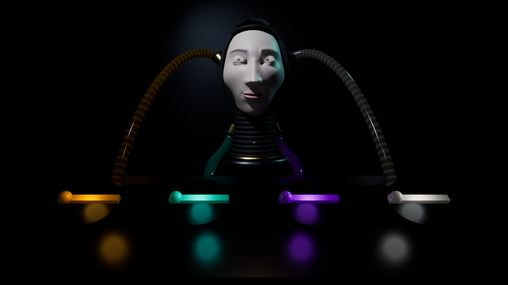

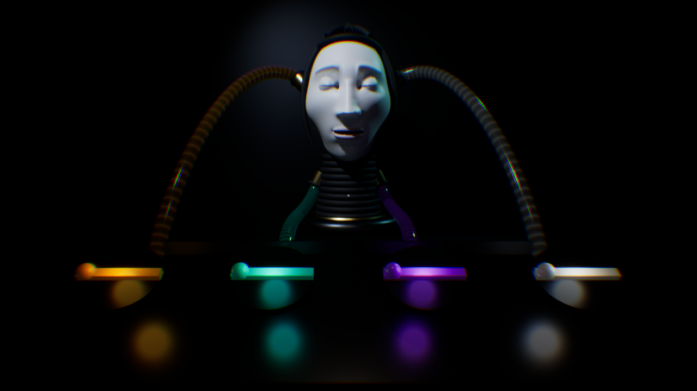

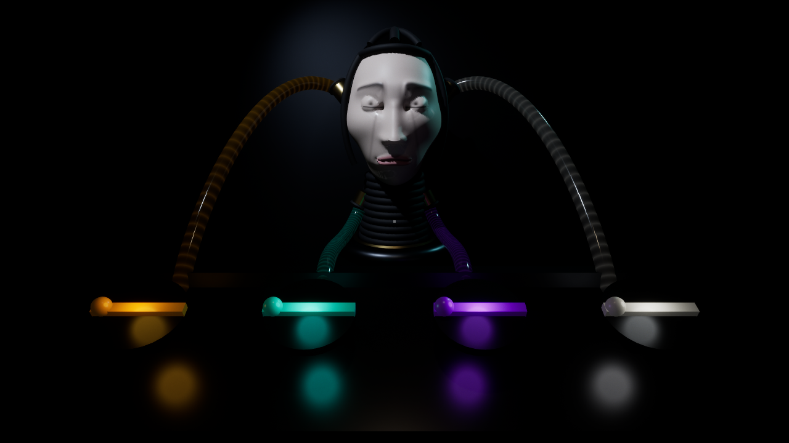

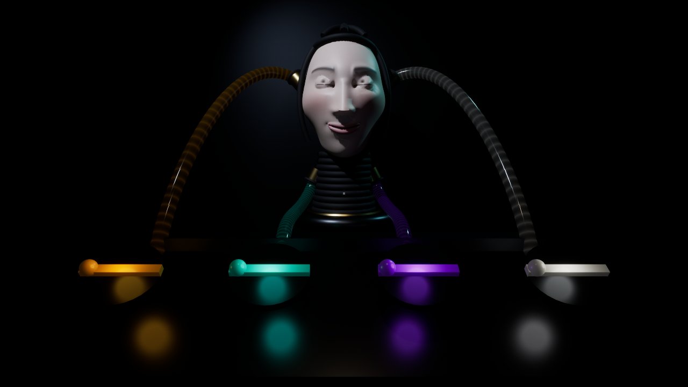

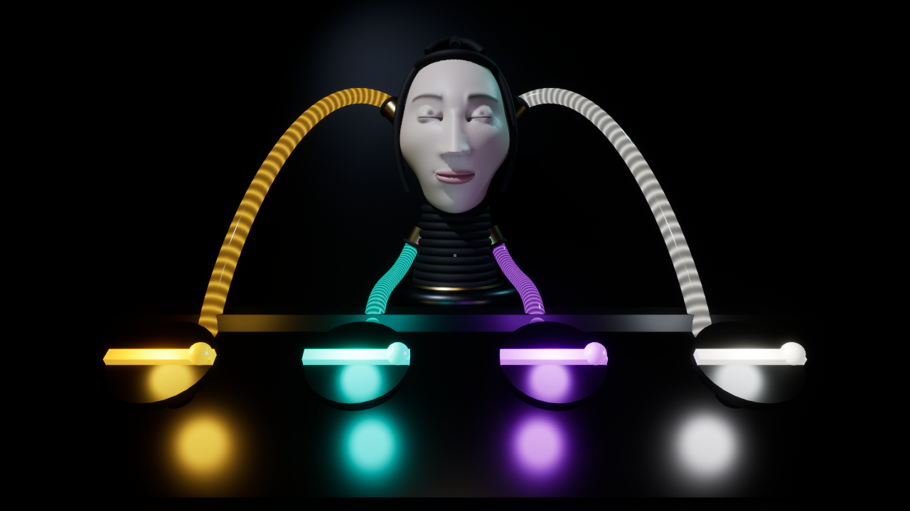

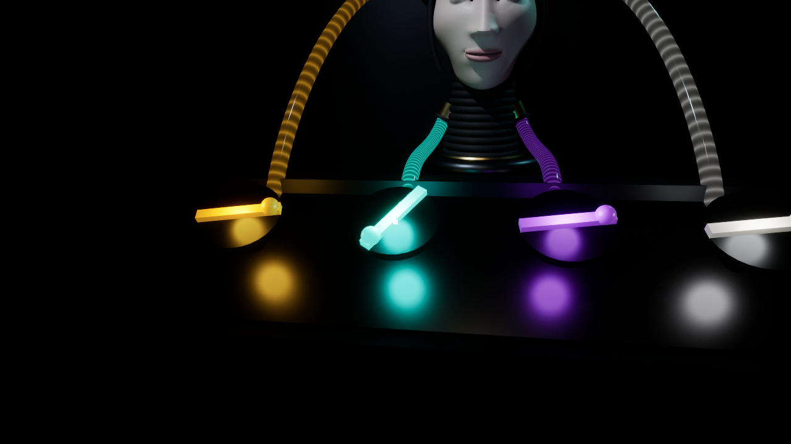

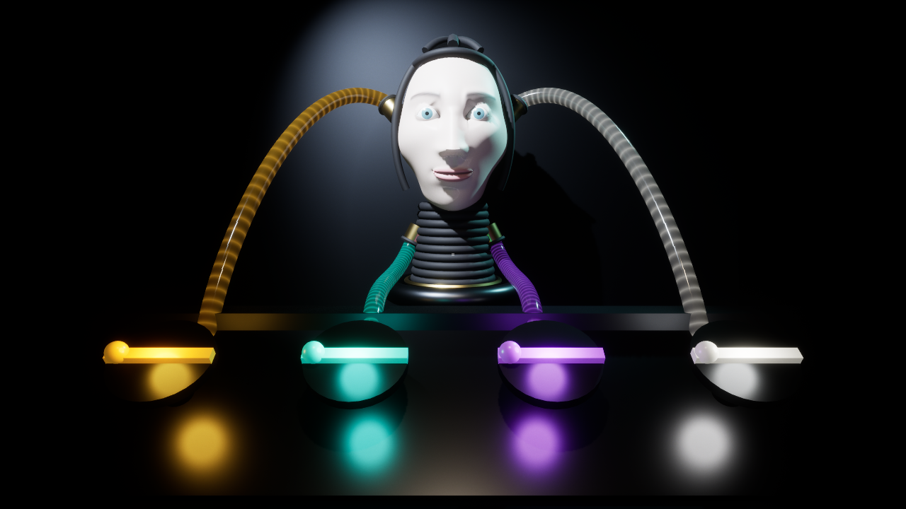

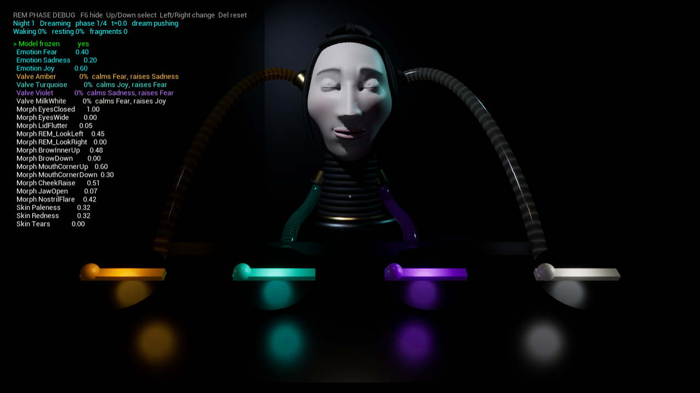

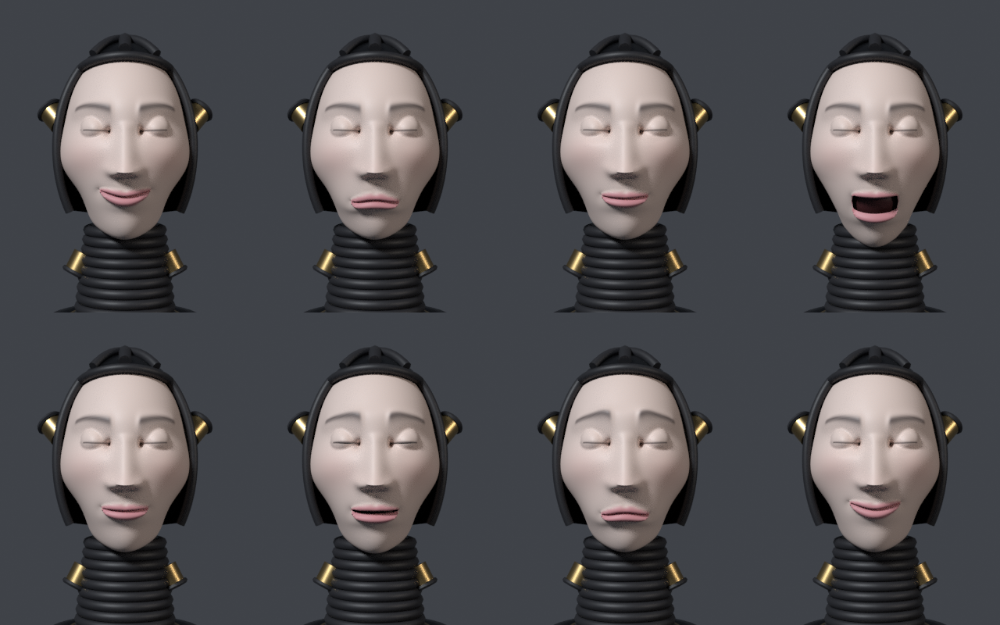

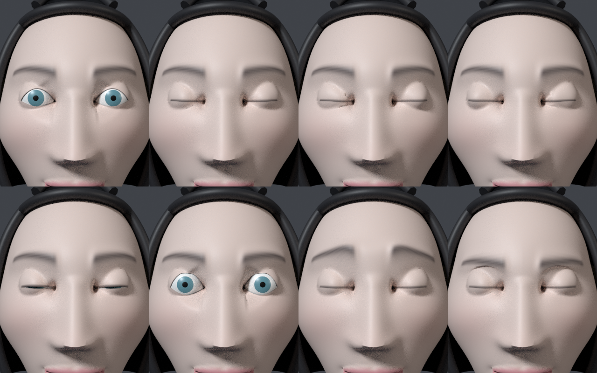

### 2026-11-12 08:45 – A measured tuning proposal, and a sound tool the agent may not run
- Goal: fix "waiting wins every night", and get a local tool for sound effects.
- What the AI did:
  - Proposed a rule ("feelings stay, leftovers fade") and measured it with the real model before asking, in the
    automation test `MegaJam.Proposals.SettleRule`: untouched for 30 minutes nothing is won or lost; an attentive
    player wins the beginner night in 67 s and night 1 in 93 s on all 40 shuffles; a careless one still wins; a
    wrong valve fully open wakes her within 3 to 4 s. The game's values were not changed.
  - Compared local sound effect models by licence and picked MOSS-SoundEffect v2.0 (Apache-2.0, public): the
    others either need an account and limit revenue, or have non-commercial weights.
  - Downloaded and checksum-verified the model weights, and wrote the setup and generation scripts and the
    prompts for 17 sounds (`Tools/Audio`).
- What we did / decided (Thomas): asked for a proposal on the waiting rule; Patrick runs no second agent on the
  code; sound effects from a local tool the agent chooses, music with Suno. At 09:00 approved the rule; the
  agent made it the default and turned the measurement into five regular tests (waiting does not win, dreams
  stay below waking, every night winnable by an attentive and a careless player, mistakes wake her, leftovers
  fade). 14 tests in total. Ran the tool's setup and the generation himself.
- What went wrong / what we learned:
  - Claude Code's safety check let the agent download the model weights, which are data, but refused to let it
    install and run the tool's code. So the agent prepared everything and a person runs two scripts. The agent
    also cannot hear: which take is good is a human decision.
  - The first generation run crawled at 61 s per step, over 100 minutes for one sound. The agent read the
    terminal and the tool's source: it puts all three model parts on the graphics card at once, about 11 GB on
    a 12 GB card that the desktop already uses, so everything spilled into shared memory. The agent switched on
    the tool's own offloading, so only the part in use sits on the card. Result: 4.5 steps per second, about
    25 s per take. The script now also stops by itself when the first steps are that slow.
  - Result at 09:24: 51 takes of 17 sounds in 22 minutes. The agent checked them the only way it can, by level
    and spectrogram: calm breathing shows two to three breaths in 10 s, fearful breathing about eight in 8 s,
    each gasp is one sharp event, the valve turn is a run of fine clicks, the drone is steady low energy. None
    is clipped, but the model's level follows the prompt: "quiet" sobs came out 50 dB below the stings. The
    agent levels them for listening (`Tools/Audio/Build-Audition.ps1`) and changed the generator to write
    32-bit float so nothing is lost next time. Which takes are good is for the team to hear.

### 2026-11-12 09:45 – Sound in the game, wired and tested by an agent that cannot hear
- Goal: hear the slice. Wire the generated sounds into the game, provisionally with take 1 of each.
- What the AI did:
  - Wrote `Tools/Audio/Apply-Picks.ps1`: for each sound it takes the take named in `Tools/Audio/picks.json`,
    levels it, fades the one-shots and cross-fades the end of every loop into its beginning, so it repeats
    without a click. The asset script now imports the 17 files and fills a data asset, `DA_Audio`: one sound and
    one volume per name, so the mix can be changed in the editor without a compiler.
  - Wrote `UMJAudioDirector` in C++. Her breathing is three loops cross-faded by her emotions. She gasps on
    every startle of the face, sobs and laughs softly in her sleep. Each tube is heard flowing as far as its
    valve is open; a wheel creaks while it turns and clicks on grab, release and end stop. The machines whine
    when an emotion nears the top and vent vapour past 90 %. Deep sleep brings a sigh and a low swell, waking
    her a sting.
  - Tested sound the way it tests everything else: the smoke test asks the game what is playing. 17 new checks,
    28 in total: for example "fear: her breathing turns fast", "turning a valve: its wheel is heard creaking,
    the others stay quiet", "waking up: her breathing stops", and one that the loops really run on the audio
    device. The test mutes its own output. All 28 pass in the editor build and inside a packaged Development
    build, with no errors or warnings in the log; the Shipping configuration compiles.
- What we did / decided (Thomas, 09:29): the sounds go in now with take 1 of each; the team picks by ear later.
- What went wrong / what we learned:
  - The checks prove that the right sound starts at the right moment. They say nothing about how it sounds.
    Nobody has listened yet, and take 1 is a placeholder, not a choice.
  - Four of the seventeen are suspect before anyone hears them. The model rendered the three breathing loops
    and the sob very quietly (peaks 30 to 53 dB below full scale), and the first run saved 16-bit files, so the
    27 to 50 dB of gain they need also lifts the rounding noise. The generator has written 32-bit float since
    then; these four need one more run, and only a person may start it.
  - The master prompt asks for MetaSounds. The agent used plain sound waves on audio components, with volume
    and pitch driven from C++: quicker to build and checkable without the editor. The data asset accepts any
    sound source, so a MetaSound can replace a wave later without a code change.
- Screenshot / clip: none, sound only

### 2026-11-12 10:40 – The first person plays, and finds in minutes what the tests missed
- Goal: let a person play the slice, then fix what they find.
- What the AI did:
  - Started the packaged build for Thomas, after waiting two minutes for his sound generation run to release the
    graphics card. Running both at once overflows the card's memory.
  - "The crosshair does not fully reach the outer valves": worked it out from the layout instead of guessing.
    The look limit was 25°, the centres of the outer wheels sat at 26.2° and their outer rims at 30.1°, so only
    36 % of each outer wheel could be aimed at. Offered three fixes with numbers: valves closer, a wider look, or
    a bit of both.
  - "Drawing circles with the mouse is hard": proposed a vertical drag instead, with about 7 cm of mouse travel
    at 800 DPI from closed to fully open.
  - After the team's choice: both changes in C++, a new smoke check that aims at the centre and both rims of every
    wheel, and new checks with a simulated mouse (up opens by the tuned amount, sideways does nothing, down
    closes). Prepared and imported the four sounds Thomas had rendered again in 32-bit float. One build, one run
    of the tests (14 of 14) and of the smoke test (30 of 30), one package.
- What we did / decided (Thomas):
  - Played for the first time, from 09:59, first full screen, then in a window.
  - Chose: valves 18 cm apart instead of 26 with the look limit unchanged; valves turned by moving the mouse up
    and down, no circles; a new build that includes the new sounds.
  - Told the agent not to rebuild the whole project for every step.
- What went wrong / what we learned:
  - The smoke test had a check "crosshair finds the valve the player looks at", and it passed all morning. It
    aimed at the centre of the second valve only. The valve spacing and the look limit were both the agent's own
    proposals and had never been checked against each other.
  - The circular gesture was the part the agent had measured most carefully (1.19 hand circles gave 1.16 turns).
    It was accurate and still unpleasant: accuracy can be simulated, comfort cannot.
  - The agent had run the full chain after every step: build, tests, smoke test, package, smoke test in the
    package, Shipping compile. Now it builds what a change needs, checks once at the end, and packages when the
    team wants a build.
  - Seen in the new screenshots, not yet reported from play: with the crosshair on a valve her eyes are cut off
    at the top of the picture. Listed as an open question.
- Screenshot / clip: `Docs/Media/2026-11-12_valves_closer.png`, `Docs/Media/2026-11-12_valve_drag.png`

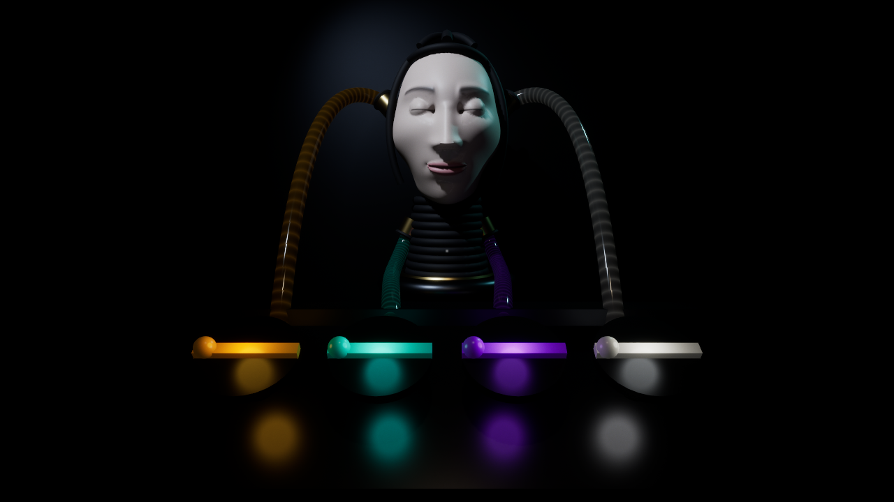

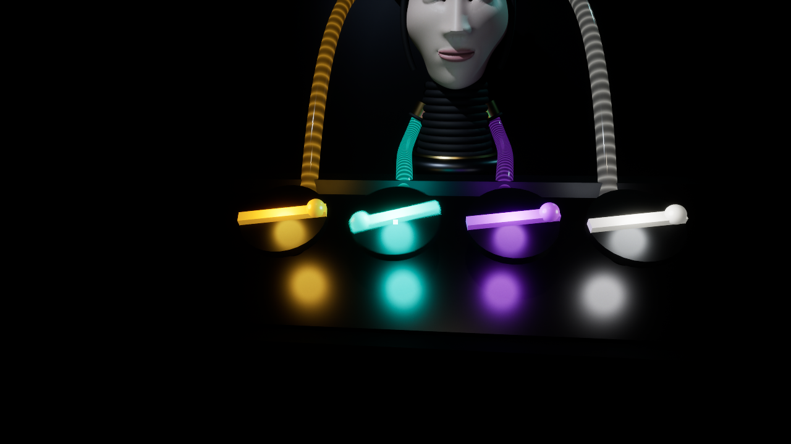

### 2026-11-12 11:15 – From a crosshair to a mouse pointer
- Goal: the next round of play feedback: a mouse pointer instead of the crosshair in the middle, and a camera
  that only leans after it a little, with lag.
- What the AI did:
  - Replaced the look by a pointer that the game moves itself from the raw mouse travel and draws as an arrow,
    so it behaves the same in a window, on the full screen and in the headless test. The camera eases towards
    a small lean that depends on where the pointer is.
  - Proposed starting values and marked them as proposals: 8° sideways, 5° up and down, a third of a second of
    lag, 3.6 cm of mouse travel from the top of the picture to the bottom at 800 DPI.
  - Rewrote the mouse part of the smoke test for the pointer: it reaches every wheel from rim to rim, it stops
    at the edge of the picture, the camera trails it and settles, and the arrow is drawn on the very pixel
    where the engine sees the spot it points at (measured: 560, 486 against 560, 486).
  - One build, one run of the tests (14 of 14) and of the smoke test (32 of 32), one package.
- What we did / decided (Thomas): asked for the pointer and the lagging camera at 10:37. Played the result at
  11:28: "looks good, feels good". The starting values stay.
- What went wrong / what we learned:
  - The pointer also removes a problem the agent had listed as open half an hour earlier: with the crosshair
    her eyes were cut off whenever a valve was aimed at. Now her whole face stays in the picture.
  - The valve spacing chosen at 10:25 was fitted to a look limit that no longer exists. It stays at 18 cm until
    the team says otherwise.
  - The numbers were the agent's guesses at what feels right. This time they held up in a person's hands.
- Screenshot / clip: `Docs/Media/2026-11-12_pointer_on_valve.png`, `Docs/Media/2026-11-12_camera_leans.png`

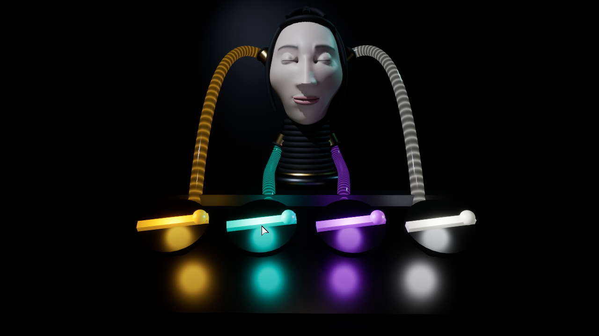

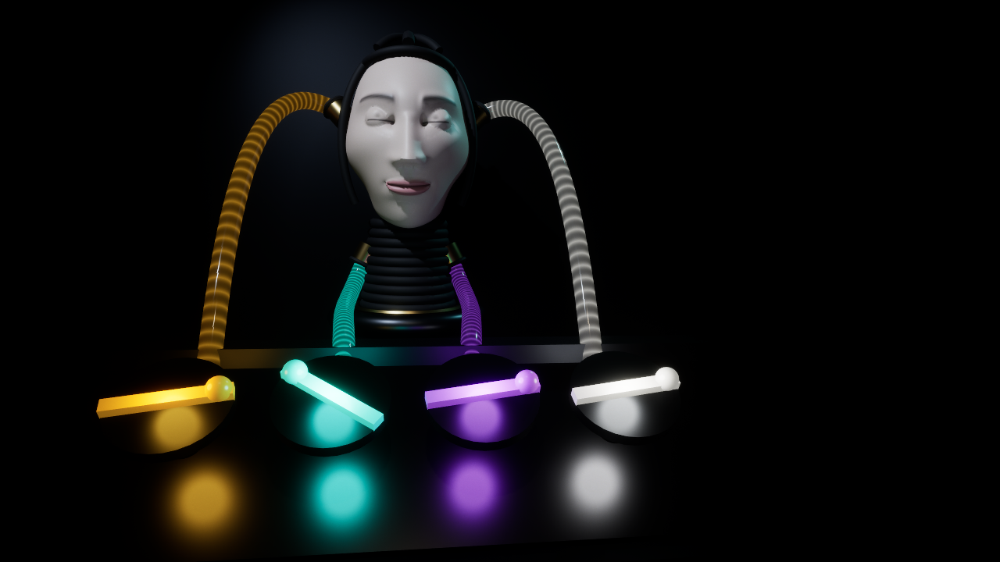

### 2026-11-12 12:05 – The cutting room: the theme becomes playable
- Goal: the Director's Cut itself. Dream fragments the player earns, a cutting room, endings.
- What the AI did:
  - Proposed a design on one page: the player shoots the footage by dosing, cuts three of the night's dreams
    into an order, and the last one decides how she wakes. Four endings, no score, cut again as often as wanted.
  - After the approval built it in C++ within half an hour, on what was already there. A fragment records five
    seconds of what she felt; its tone is the feeling that filled the phase most, so an overdose changes the
    footage. In the cutting room the console is the desk, the pointer is the hand, and her face is the screen:
    pointing at a slide makes her dream it again, with the same expressions, light and sound as in the night.
    The endings reuse it all too: eyes that open gently, slowly or wide, a warm or a cold light, a sigh or a
    sting.
  - Seven new automation tests (21 in total) for the fragments, the cut and the endings, and fifteen new smoke
    checks (47 in total) that walk through the cutting room with a simulated mouse: point, pick up, carry, drop,
    final cut, screening, ending, cut again.
  - Counted what the design means for the nights as they are tuned: which tones a well played night yields
    over 40 shuffles and which endings those allow.
- What we did / decided (Thomas, 11:36): approved the proposal as it stood.
- What went wrong / what we learned:
  - The count showed what the proposal had not foreseen. Because the tone comes from the play, night 1 is
    lopsided: in 17 of 40 shuffles a well played night holds no joy at all, so the gentle ending cannot be cut,
    and the ending without waking, meant to be rare, can be cut in 9. A change to one dream fixes most of it
    (35 of 40 and 4 of 40). It is measured and written down, not applied: tuning is the team's call.
  - The master prompt asks for widgets. The lines of text are drawn by the HUD instead, and the timeline lies
    on the console. Quicker, and her face stays the screen.
  - The slides and buttons are plain boxes and discs, and the dream lines are the agent's drafts. Nobody has
    played the cutting room yet.
- Screenshot / clip: `Docs/Media/2026-11-12_cutting_room.png`, `..._the_cut.png`, `..._screening.png`,
  `..._ending.png`

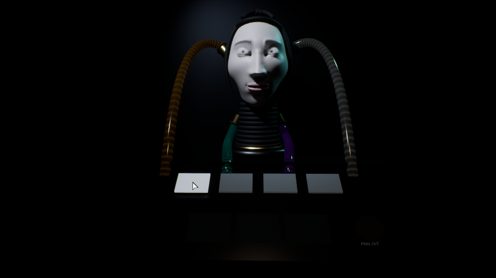

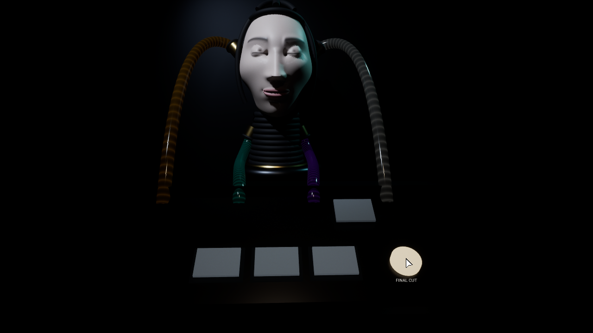

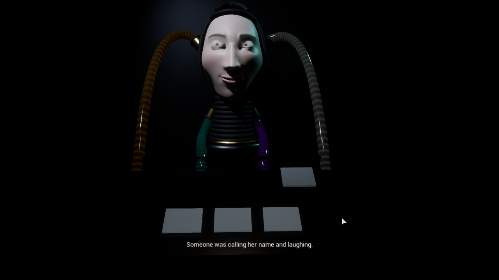

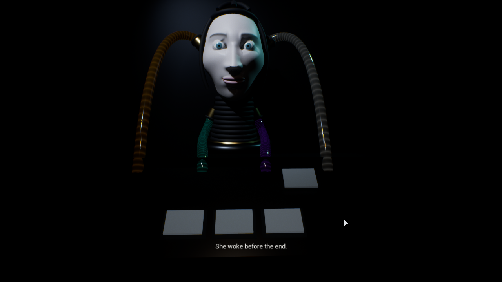

### 2026-11-12 12:30 – The inventor gets stuck in his own game
- Goal: Thomas plays the build with the cutting room.
- What happened: at 12:04 he wrote that he could not get to the cutting room because he did not know what to
  do. With a written list of what each valve does he got through the three dreams (77 s, 29 s and 60 s, read
  from the game's log) and reached the cutting room at 12:13. One minute later he asked what the slides are for
  and whether they can be moved.
- What the AI did:
  - Answered both questions from the tuning data and the code, so that he could go on playing.
  - Named the cause: the game shows neither how a valve is worked, nor that it must be closed again, nor when a
    dream is done. And in the cutting room the places for the slides were almost black.
  - Proposed hint lines for the beginner night and rest lamps on the console. After the approval built the hint
    lines: the model picks the line from what the player is doing (nothing open, the right valve, the wrong
    one, too much), a warning does not wait for the line before it, and which valve helps is never said. Lit
    the places of the cut and numbered them with pips.
  - One new automation test (22 in total). It failed at first because of the agent's own scenario: too much
    against fear flips into sadness, not into joy, so the test never let her rest.
- What we did / decided (Thomas, 12:16): hint lines and visible places, yes. The rest lamps are not decided.
- What went wrong / what we learned:
  - "Rules are discovered, not explained" had been built as "nothing is said at all". The beginner night was in
    the plan precisely so that judges understand the loop within minutes, and it taught nothing.
  - 47 automated checks walked through the cutting room, picked up a slide and dropped it in a place. None of
    them could notice that a person does not know what a grey rectangle is for. Only a person finds that.
  - The agent added a seventh line the team had not seen ("She woke. The night begins again.") and said so.
- Screenshot / clip: `Docs/Media/2026-11-12_cut_places.png`

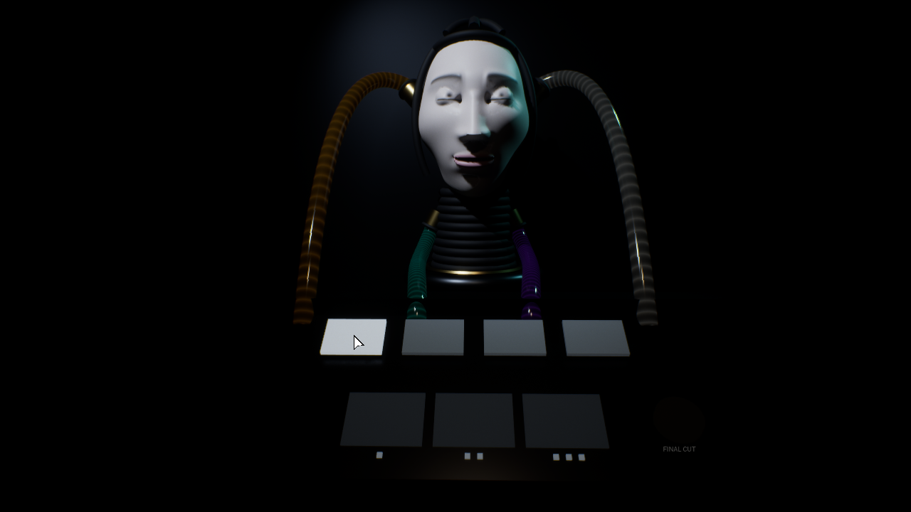

### 2026-11-12 13:05 – Patrick's console in the game
- Goal: bring the first of Patrick's generated models into the game.
- What the AI did:
  - Looked at the three models Patrick had committed, with a script that measures a model and renders it: a
    console, a wall relief and a head, one million triangles each, none with bones or morph targets.
  - Found the console's four domes by geometry (in each quarter of the width, the point that stands out furthest
    from the valve surface) and checked the result by rendering red balls onto them. Turned and scaled the model
    so the valves sit on the domes, thinned it to 350,000 triangles and wrote out its three textures.
  - Extended the asset script: it imports mesh and textures and builds the material, with the normal map's green
    channel flipped and roughness and metallic taken from the model's packed texture. The mesh uses Nanite.
  - In the room: the panel leans as far as the console's valve surface (47.7°), a plain plinth carries the
    console, and the tubes run into it.
- What we did / decided (Thomas, 12:48): the console goes in. The wall relief does not, as it is. The head later.
- What went wrong / what we learned:
  - Two things only the pictures showed. The placeholder discs covered the domes Patrick had sculpted; now only
    lever and knob show above each dome, as in his concept picture. And the tubes ended in mid-air above the
    sculpted surface; now they start inside the console.
  - Two of the five skulls in the wall relief are too close to a well-known film creature. Held back under the
    team's own rule that nothing is copied.
  - The asset script imports the face and all sounds again on every run, so unchanged assets show up as changed
    in version control.
  - Which tool Patrick used is still not written down; the rules ask for it.
- Screenshot / clip: `Docs/Media/2026-11-12_console_valves_open.png`, `Docs/Media/2026-11-12_console_asleep.png`

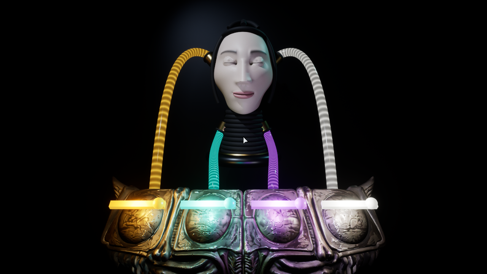

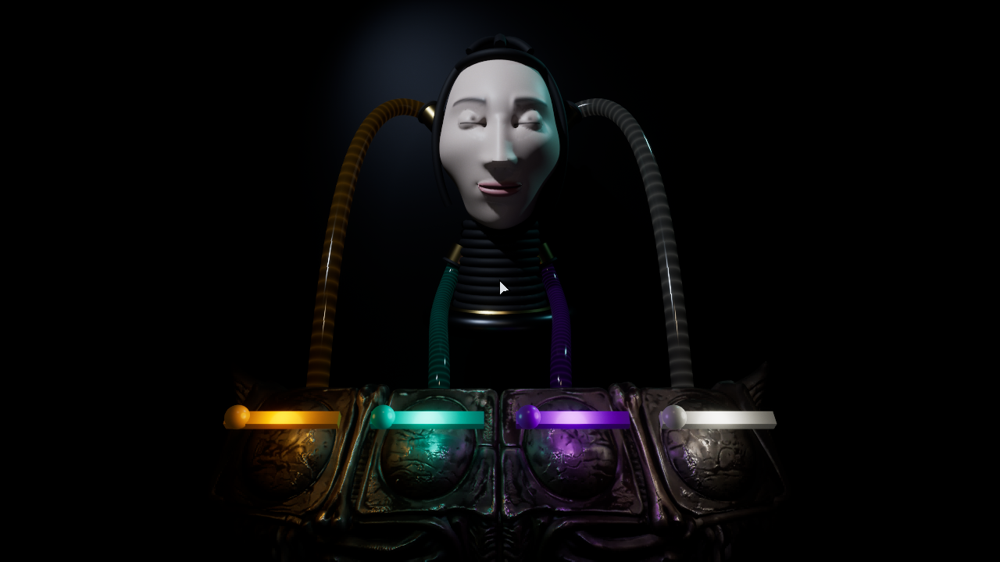

### 2026-11-12 13:30 – Reading her face, reading the switches
- Goal: two things Thomas asked for after playing: expressions that can be read while dosing, and a way to
  understand the switches.
- What the AI did:
  - Named the cause of the weak expressions by calculation: they grew evenly with the feeling, the dreams of the
    beginner night only rise to 60 %, and a player who doses well keeps them at 20 to 40 %. Proposed values in a
    table; after the approval a feeling shows at full strength from 60 % on, the tells of each feeling are
    stronger, and the shapes of the blockout face move 30 % further. Regenerated the face and looked at every
    shape again.
  - Proposed three steps for the switches that never tell the mapping, and built all three: a line at the start
    of the beginner night, a monitor with three unlabelled traces drawn into a render target, and marks on the
    console that light up once a valve has calmed a feeling.
  - Two new smoke checks for the monitor (49 in total); the test of the hint lines now also covers the first
    line and the marks.
- What we did / decided (Thomas, 13:12 and 13:14): stronger expressions with the proposed values; all three steps
  for the switches; Patrick's head after that.
- What went wrong / what we learned:
  - The first pictures showed the monitor half outside the picture and drawn with lines too thin to read, and
    the marks too small. Moved, enlarged and framed after looking; nothing a check could have told.
  - A full expression from 60 % on means the face no longer tells 60 % from 100 %. What still grows up there are
    the starts, the lid flutter, the whine of the machines and the monitor.
- Screenshot / clip: `Docs/Media/2026-11-12_monitor_and_marks.png`, `Docs/Media/2026-11-12_fear_stronger.png`,
  `Docs/Media/2026-11-12_sadness_stronger.png`

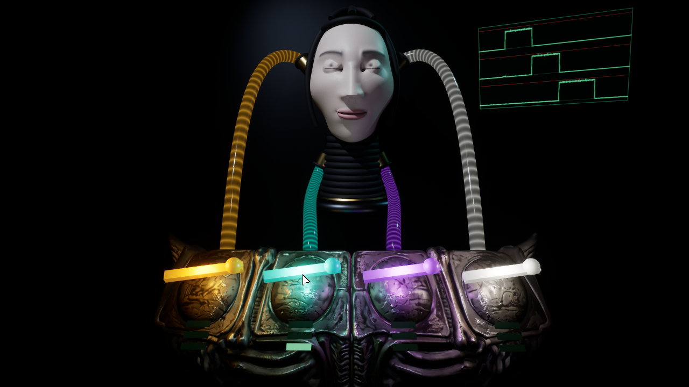

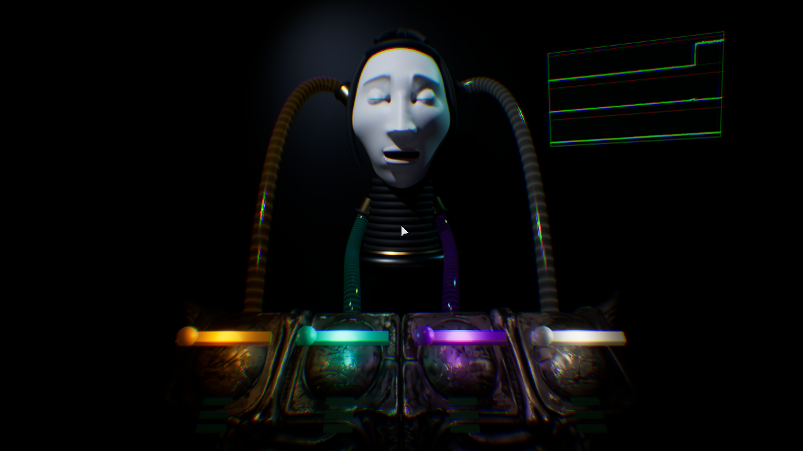

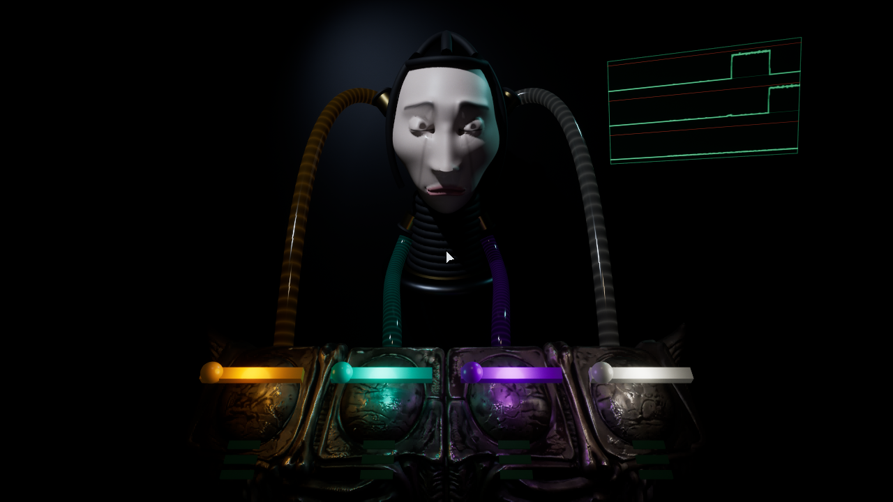

### 2026-11-12 14:25 – Patrick's head learns to sleep, to fear and to smile
- Goal: Patrick's generated head in the game with all twelve expressions. It came as one sculpted surface of a
  million triangles with its eyes painted open, its mouth shut, and no bones or shape keys.
- What the AI did:
  - Wrote a measuring tool (`Tools/Blender/face_landmarks.py`: the model from the front and the side under a
    grid), read the places of eyes, lids, nose, mouth and ear from its pictures, and then measured the edges of
    the lids and the line between the lips with rays cast at the surface.
  - Found out from those numbers how the model is built: each eye is a flat plate with an eye painted on it,
    4 mm behind the rims of the lids. So the lids close by stretching both rims over the plate until they meet,
    and the plate folds away behind them. No new texture was needed.
  - Wrote `Tools/Blender/prepare_face.py`. It welds and thins the model (1,000,000 to 127,000 triangles, dense
    at the eyes and the mouth), cuts the mouth open along the lip line and puts a dark body behind it, builds the
    twelve shape keys, paints the masks for blush, tears and lips, adds the bones and passes Gate 1.
  - Imported the result as `SK_Face` with a skin material that shows the model's texture and answers to
    Paleness, Redness and Tears. No C++ changed: the face contract of the blockout held.
  - Checked it where it counts: 49 smoke checks in the editor build and again inside a packaged Development
    build (14:55), with the pictures of both looked at.
- What we did / decided (Thomas, about 13:10): try the head; the blockout face stays as a fallback.
- What went wrong / what we learned:
  - The model's file splits the surface along every border of its texture pieces, and thinned like that it
    would have torn open there. The importer's own merge option closed 8,000 of 275,000 doubled points; welding
    by position closed all of them.
  - Stretching the rim of a lid also stretches every small step in it, five times. The closed lid is now laid
    onto a smooth surface between the two rims. The first attempt at that made the lash line ragged, which only
    a strong close-up showed.
  - The first import reported success while the game said "No skin material set": the script had changed a copy
    of the material slot. It now reads the slot back and fails if the material is not there.
  - Seen only in the game's own pictures: the bust ended in mid-air above the console, and tears did not show
    on the dark, half-metal skin. A ribbed conduit now carries on below the bust, and tears glint.
  - A relative output path written with forward slashes made Blender put two pictures into `C:\Saved`. The
    scripts now make their paths absolute.
- Screenshot / clip: `Docs/Media/2026-11-12_head_expressions.png`, `Docs/Media/2026-11-12_head_in_game.png`,
  `Docs/Media/2026-11-12_head_awake.png`

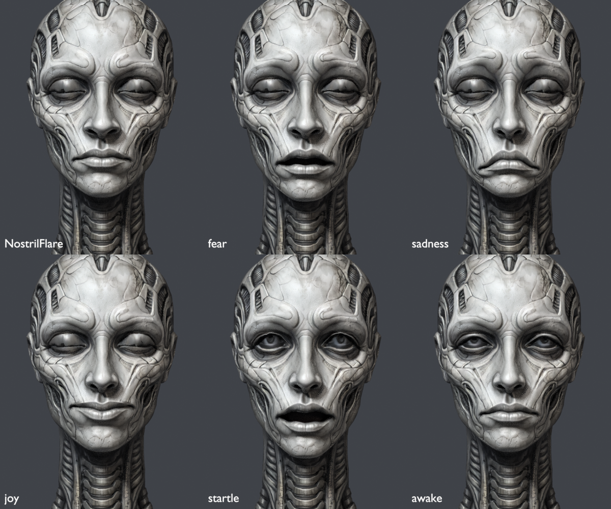

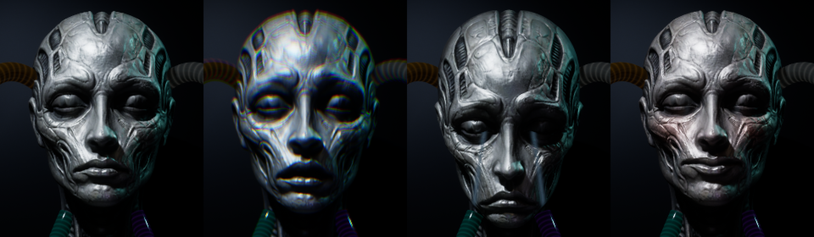

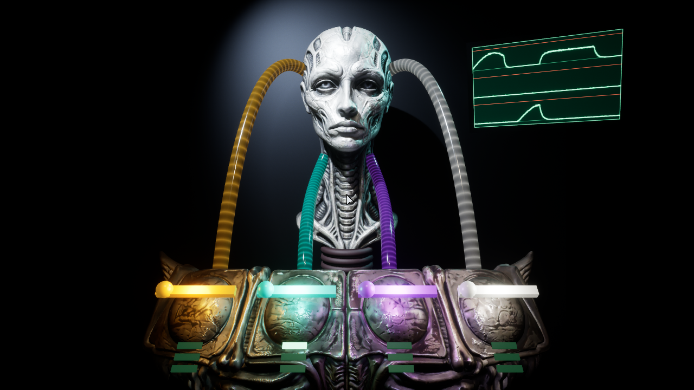

### 2026-11-12 16:25 – She weeps, and three more things a look at the showcase turned up
- Goal: Thomas asked for a showcase that steps her face through its extremes, watched it, and named four things:
  her left eye is lost in sadness, there are no tears to see, the levers sit too high on their domes, and one
  valve does nothing in the beginner night.
- What the AI did:
  - Built the showcase (F7, or `-MJShowcase`) and turned the levers round, so that the knob follows the hand.
  - Found the cause of each of the four before proposing anything. No light reaches the side of her face away
    from the key light once her head sinks. The tears were two pixels wide and took three seconds to come. The
    lever stands 2.5 cm above the top of its dome and so looks shifted up from the seat; how far can be
    calculated (4.4 to 5.2 cm). And violet calms a feeling the beginner night does not have.
  - Built all four after the go-ahead: a soft light from the console, beads of tears that run down her cheeks
    and a shudder with every sob, the lever 4.5 cm down the slope, and violet as a clean valve against joy.
  - Measured what the new valve does to the beginner night with the bots instead of guessing: 67 s, as before.
- What we did / decided (Thomas, about 16:00): all four as proposed. Patrick named his tools: Google Nano Banana
  for a preview picture, Tripo for image to 3D.
- What went wrong / what we learned:
  - The beads need to know how far down the cheek a point lies. The first idea, the resting position of each
    vertex, is only there for the vertex shader. The mesh now carries it as a second set of texture coordinates.
  - With the new light on her face the first beads were too faint to see, and a single picture cannot show that
    anything runs. The smoke test now takes two pictures of her sadness a moment apart.
  - A text replacement with `sed` had turned `CLAUDE.md` from Windows to Unix line endings without a word.
- Screenshot / clip: `Docs/Media/2026-11-12_weeping.png`, `Docs/Media/2026-11-12_levers_on_domes.png`,
  `Docs/Media/2026-11-12_faces_with_fill_light.png`

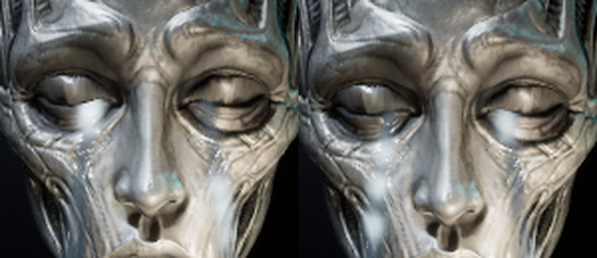

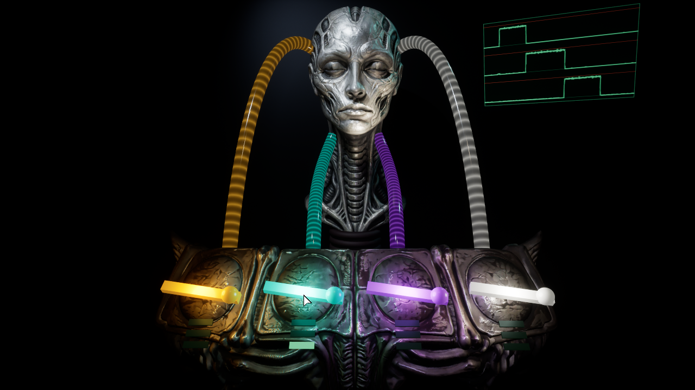

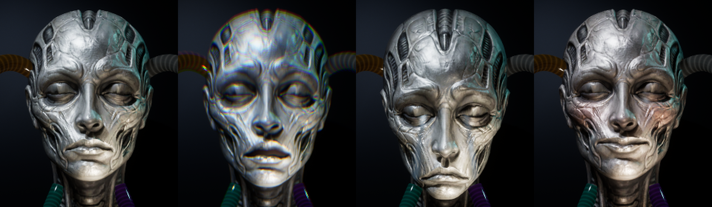

### 2026-11-13 10:30 – Losing costs something, three nights

- Until now a wrong dose restarted the night with newly shuffled valves, as often as it took: nothing could be
  lost, and what the player had learned was thrown away. Thomas asked how the game can be lost and how the first
  three levels are built; the agent laid out the state in the code and three options, the team chose.
- Built: waking costs the fragment of that dream and the night goes on; the valves keep their effect for the
  night; three nights (learning, finding out, mastering with the nightmare), then the end screen.
- Three new automation tests cover it (25 in all); the smoke test still passes its 65 checks. The bots win every
  night on all 40 shuffles. No person has played the three nights yet.

### 2026-11-13 13:00 – Nightmare with shock wave and fever, the Brain Room

- The nightmare got its own events: a shock wave ("ALL VALVES OPEN!", then ease down) and a fever that a fifth
  key cools. Lesson from the first test by a person: the fever came and went unnoticed, and a shuffle in which
  three valves raise the same feeling made "all valves open" wrong. The automated players had passed both,
  because they compute instead of reading the screen. Fixed by making the fever unmistakable and by switching
  side effects off while the shock wave lasts.
- Thomas asked for an interlude: synapses in a cross-section of her brain. The agent proposed three sizes and
  recommended the small one; it was built in about an hour as pure logic with tests first (every net can be
  solved, nothing gets stuck), then the picture. The first picture showed the lanes of the net running into each
  other on the sloping panel; standing the net upright fixed it.
- First Shipping package built and started. 32 automation tests, 75 smoke checks.

### 2026-11-13 17:30 – A second Brain Room: the synapse grid

- Thomas described another Brain Room (a grid, red points to click away, white crystals to keep) and asked for
  ideas. The agent proposed spreading nests, shielding crystals, decoys and a difficulty that follows the night.
  Asked whether to replace the routing net, Thomas first said yes, then stopped the agent ("replace nothing")
  before anything was changed; the grid was built in addition and follows the net after the last night.
- Logic first with tests, then the picture. Two tests failed and both pointed at the design, not at the code:
  crystals that kept new seeds away shielded nearly the whole grid after a good night, so the game would have
  played itself (now only spreading is blocked); and a grid left alone overgrows until a late crystal finds no
  room (the test now allows that).
- A slip of the agent: an edit directive in the wrong form was written into `MJGameMode.cpp` as text; the
  compiler caught it at once.
- 41 automation tests, 80 smoke checks. Picture: `Docs/Media/2026-11-13_synapse_grid.png`.
- Thomas played it twice and found it too easy with one seed at a time: the seeds now flash up three at once,
  15 instead of 8 in a game. 42 automation tests.

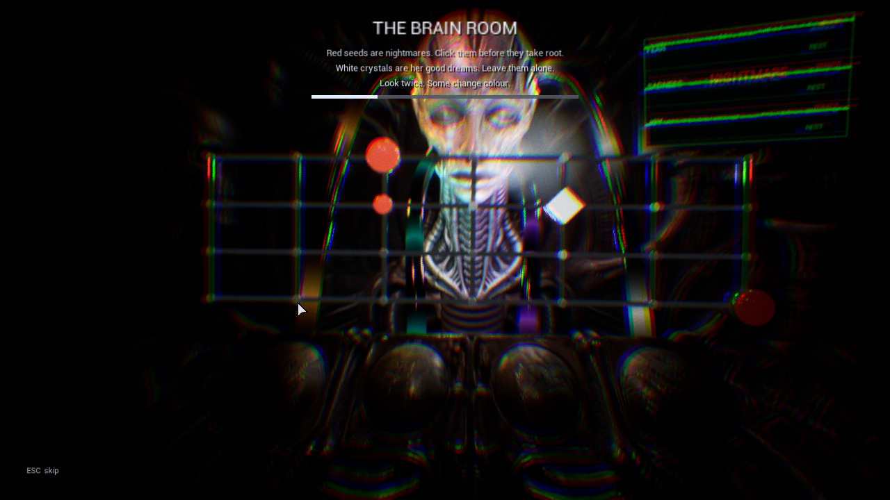

### 2026-11-13 18:15 – A dream of longing

- Thomas asked for an erotic dream. The agent pointed at the jam's rule (fit for players of 13 and older) and
  proposed a hinted version under the name of longing, as a mixed dream of joy and sadness instead of a fourth
  feeling; Thomas said to build it. It reuses what was there: the third dream of night 1, five recorded lines,
  the skin's redness, the wall light.
- The agent misread the log's frame counter (it wraps at 1000) as a frame rate of 13 and told Thomas the grid
  stutters; a recorded profile showed 4 ms per frame. Nothing was changed for it.
- 43 automation tests, 82 smoke checks. Picture: `Docs/Media/2026-11-13_longing.png`.

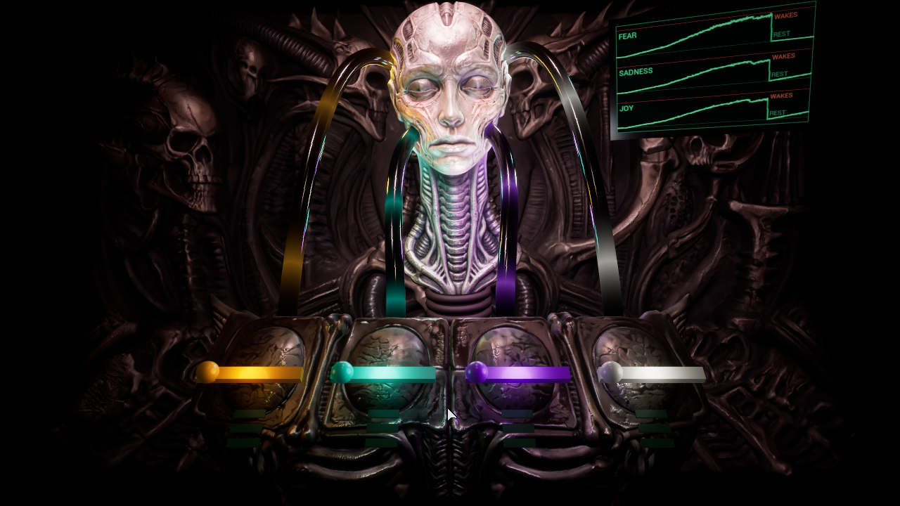

### 2026-11-13 19:00 – Pumping tubes, a darker room, prompts for the film pictures

- Thomas asked for tubes that pump and for a darker background. The first try made the room brighter, not
  darker: stronger tube lights with a reach of 320 cm lit the whole wall. The smoke pictures showed it; the reach
  is now 190 cm and the wall light is down to 20 candela.
- The agent wrote `Docs/FilmPrompts.md`: for each of the 27 dream lines (and the four endings) a file name, the
  subtitle and an image prompt, with one style block, for the team to generate with Google Nano Banana. The game
  does not show pictures on the film yet.
- Later the same evening Thomas played all of it: the room got too bright from night to night, and the net of
  the Brain Room was too fast to play. The wall light per night is off for now, the balls run at less than half
  their speed. The automated player in the tests had managed the old speed; a person turning a valve by mouse
  did not. 43 automation tests, 82 smoke checks.

### 2026-11-13 20:00 – Pictures on the film

- Thomas generated 31 pictures from the agent's prompts and asked for them on the film in the cutting room.
  The agent compared the files: ten were byte-for-byte copies of others, and most of sadness and joy sat under
  other names. It made a contact sheet, looked at every picture, and wrote the mapping into the import script
  instead of renaming the team's files. 21 distinct pictures are in the game; six dream lines have none yet.
- The first picture on the desk was nearly black: the unlit material needs far more brightness than a lit
  surface under the room's dark exposure (the same lesson as with the mist).
- A click on a valve now switches its synapse in the Brain Room. 43 automation tests, 82 smoke checks.

### 2026-11-13 21:00 – An alarm for too much

- Thomas asked whether an alarm had been planned for valves left open too long. The agent listed the warnings
  there were; Thomas answered that he saw none of them when playing. Reading the code showed why: they existed
  but were bound to the guided night or to thresholds a player rarely reaches. The agent's table had described
  what the code can do, not what a player meets.
- The alarm is built: large words across the picture, the valve that is too much blinks red, a ticking whine.
  The first smoke case (every valve open) showed no overdose at all: flooding raises every feeling, so nothing
  is "too much" any more. The case is now one wrong valve. The first pictures also caught the words in a blink
  pause twice, because the smoke test runs to the same moment every time; the words pulse now and never go out.
- 44 automation tests, 84 smoke checks. Picture: `Docs/Media/2026-11-13_overdose_alarm.png`.

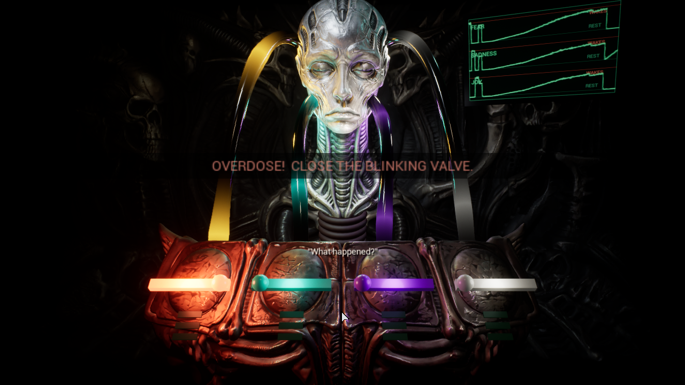

### 2026-11-14 11:00 – The last three ideas

- Thomas played the game through several times and had almost no wishes left; he asked the agent for ideas. Of
  four, he took three (the fourth was a sound for the alarm; he finds the sound right everywhere): an easier
  synapse grid, a grid that shows on her face on the end screen, and a line that names her film by the tones of
  the cut.
- The first smoke run after the change stopped in its fourth frame with an assertion inside the engine
  (`FMorphVertexBufferPool::GetReadingIndex`, `SkeletalRenderGPUSkin.cpp` line 336, on a background worker). The
  change touches nothing that runs at the start; the second run passed all 87 checks. Seen once so far, cause not
  found.
- 46 automation tests, 87 smoke checks. Picture: `Docs/Media/2026-11-14_end_screen_cut.png`.

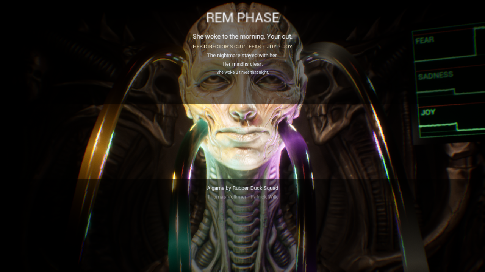

### 2026-11-14 16:00 – The net quickens

- Patrick asked for one complete prompt per picture with the right file name; the two-part prompts had not
  worked for him. The agent built `Docs/FilmPromptsPerPicture.md` from `Docs/FilmPrompts.md` with a script, so
  no prompt was retyped.
- Thomas asked for more pace in the Brain Room after a slow start. The agent first made the whole net faster
  with every dream sent; Thomas played it and asked instead for balls that speed up exponentially once they are
  half way. The first reading was the agent's guess at an open request; the second is what he meant. 48
  automation tests, 87 smoke checks.

### 2026-11-14 16:30 – All 27 dreams have their picture

- Patrick generated 21 pictures again from the per-picture prompts and committed them under the right names,
  with the import mapping set back to one file per name. The agent made contact sheets, looked at every one
  and found each where its name says; `Tools/SetupAssets.ps1` imported 31 of 31. The first contact sheet showed
  only the last pictures because the files differ in pixel format; scaling each file first fixed it.
- Brain Room: the balls now run six times as fast at the places of arrival as at the source, from 30 % of the
  way on. The first value (2.5 times from the middle) was in the game and Thomas could not see it at all.
- 48 automation tests, 87 smoke checks.

### 2026-11-14 23:15 – Her breath gets a shape

- Thomas asked how her breath could look more real; the agent listed six ideas and he chose three: a breath
  with a short way in, a long way out and a rest; breaths that differ, with a deep one now and then; and the
  mist of fear leaving her mouth with the breath she lets out. Details and values in `Docs/GameDesign.md`.
- New test for the shape of a breath, new smoke check for the mist. 49 automation tests, 88 smoke checks.
- The agent cannot judge motion from stills: whether it reads as breathing is for a person to say.

### 2026-11-15 00:00 – The balls of the Brain Room keep one pace again

- Three rounds on 2026-11-14 made the balls run faster towards their places (2.5 times from the middle, then
  from 30 % of the way, then 6 times). Thomas played the last one and took it back: it does not look good.
  The value is off, the code stays. A number the agent could test (home after 9.2 s instead of 14.6 s) said
  nothing about how it looks.

### 2026-11-15 12:00 – The pictures of the dreams are finally seen

- Thomas asked when the film pictures come: he had never seen them. They had been in the game since
  2026-11-13, on frames of film too small and too dark to make out. The agent had checked that they were
  there, in stills it looked at closely, and never asked whether a player would notice them.
- Now the screening shows the picture of the dream that plays large beside her face. One new smoke check
  (89), 49 automation tests.
- Thomas decided that the pictures with the dreamer seen from behind stay, that the music made on a paid Suno
  plan may be used, and that nothing has to be mentioned for the voices.

### 2026-11-15 12:30 – GPU crashes of the packaged game on the development machine

- The Shipping package built from commit 63 was started twice in full screen on the development machine (RTX
  5070). The first start ended after about 15 seconds, in the intro, with a GPU crash (`GPUCrash`, "GPU Crash dump
  Triggered", D3D12; report in `%LOCALAPPDATA%\MegaJam\Saved\Crashes`). The second start, a minute later, ran
  for 45 seconds without trouble. Cause unknown. It is the first crash report of a packaged build; earlier
  starts that were gone after 20 seconds left none and had been closed by Thomas.
- The agent then started the packages many times and counted the crash reports. Shipping with DirectX 12: 7
  crashes in 36 starts (4 of 21 in full screen, 3 of 15 in a window), always the same GPU crash 4 to 12 seconds
  after the start. Shipping with `-dx11`: 0 of 15. Development with DirectX 12: 0 of 10. The smoke run of the
  Development package with `-dx11` passed all 89 checks and looks almost the same (the tubes glow a little less).
  The crash place could not be read from the dump, and the cause is unknown.
- Thomas started the same package on a second machine with another graphics card and saw no crash; how many
  starts is not recorded. He never saw a crash himself on the development machine either: they happened in the
  agent's test runs. The agent proposed to start the game with DirectX 11. Thomas decided on 2026-11-15 to
  leave everything as it is. Known risk: a start that ends in the intro on some graphics cards; starting the
  game again, or with `-dx11`, gets around it.
